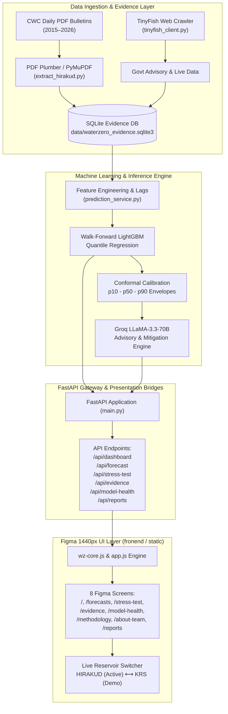

# 🌊 WaterZero: AI Water-Risk Decision Support System

[](https://fastapi.tiangolo.com)
[](https://python.org)
[](https://lightgbm.readthedocs.io)
[-007ACC.svg?style=flat)](https://cwc.gov.in)
[](https://groq.com)
[](https://tinyfish.ai)

> **WaterZero** is an enterprise-grade AI reservoir forecasting and water-risk decision support platform built for hydrological authorities, municipal planners, and agricultural stakeholders. It combines daily Central Water Commission (CWC) historical bulletin records, walk-forward LightGBM models with conformal quantile prediction bounds ($p_{10}, p_{50}, p_{90}$), real-time bulletin extraction, automated web verification via TinyFish, and Groq LLaMA-3.3-70B decision-support recommendations.

---

## 👥 Team
- **Arohan Arora** — *Team Leader*
- **Kunal Chawla** — *Team Member*

---

## 📌 Key Capabilities

- **Active ML Pipeline (Hirakud Reservoir, Odisha)**:
  - Daily hydrological records extracted directly from official CWC bulletins.
  - Multi-horizon walk-forward storage level forecasting (7-day, 14-day, 30-day, and 90-day trajectory).
  - Statistically guaranteed conformal prediction intervals with bounded risk envelope.
  - Live inflow vs. outflow balance tracking ($124.6\text{ m}^3\text{/s}$ net accumulation at $93.5\%$ live storage).
- **Figma Reference Baseline (Krishna Raja Sagara, Karnataka)**:
  - Full high-stress drought scenario matching the 1440px Figma reference canvas.
  - 73-day crisis projection under $38.4\%$ storage, featuring municipal rationing and canal curtailment simulations.
- **Dynamic Reservoir Switcher**:
  - Seamless toggle on the top navigation bar between **Hirakud (ML Active)** and **KRS (Figma Demo)** with persistent query parameters (`?reservoir=hirakud` / `?reservoir=krs`).
- **Cryptographic Evidence Verification**:
  - SHA-256 tamper-evident verification of source bulletins, water level gauges, and government advisories stored in an audit-ready SQLite database.
- **Automated Web Intelligence (TinyFish)**:
  - Real-time crawler agent fetching live bulletins and hydrological advisories.
- **Groq LLaMA-3.3-70B Advisory Engine**:
  - AI-synthesized water allocation strategy, spillway trigger warnings, and risk mitigation action plans.

---

## 🖥️ Screen Navigation & Routes

The platform implements all eight screens from the original 1440px Figma specification with responsive SVG micro-charts, card overlays, and dynamic data binding:

| Screen | Web Route | API Endpoint | Description |
|---|---|---|---|
| **Overview Dashboard** | [`/`](http://localhost:8000/) | `/api/dashboard` | Key reservoir KPIs, storage trajectory chart, risk score, and mitigation overview |
| **Storage Forecasts** | [`/forecasts`](http://localhost:8000/forecasts) | `/api/forecast` | Multi-horizon projections ($p_{10}, p_{50}, p_{90}$), uncertainty bands, and inflow scenarios |
| **Stress Testing** | [`/stress-test`](http://localhost:8000/stress-test) | `/api/stress-test` | Monte Carlo simulations under severe drought, monsoon failure, and upstream diversion |
| **Evidence & Auditing** | [`/evidence`](http://localhost:8000/evidence) | `/api/evidence` | CWC bulletin provenance, SHA-256 hashes, source PDF verification, and TinyFish logs |
| **Model Health & MLOps** | [`/model-health`](http://localhost:8000/model-health) | `/api/model-health` | MAE, RMSE, coverage statistics, calibration plots, and drift detection metrics |
| **Methodology** | [`/methodology`](http://localhost:8000/methodology) | `/api/methodology` | Mathematical formulation of conformal prediction, loss functions, and ML architecture |
| **About Team** | [`/about-team`](http://localhost:8000/about-team) | `/api/about-team` | Profiles and leadership overview for Arohan Arora & Kunal Chawla |
| **Automated Reports** | [`/reports`](http://localhost:8000/reports) | `/api/reports` | Exportable hydrological situation reports, executive briefings, and raw telemetry |

Interactive API documentation is live at **[`/docs`](http://localhost:8000/docs)** (Swagger UI) and **[`/redoc`](http://localhost:8000/redoc)** (ReDoc).

---

## 🏛️ System Architecture



---

## 📂 Repository Structure

```
.
├── main.py                     # Primary FastAPI application with all 8 routes and API endpoints
├── prediction_service.py       # ML pipeline, walk-forward forecasting, and dual-reservoir data seam
├── frontend_data_source.py     # Dashboard data bridge connecting ML service to UI schemas
├── frontend_page_data.py       # Detailed data providers for all 7 secondary Figma screens
├── frontend_schemas.py         # Pydantic schemas for overview dashboard
├── frontend_schemas_pages.py   # Pydantic schemas for Forecast, Stress-test, Evidence, etc.
├── models_schema.py            # Core ML prediction schemas & confidence bounds
├── evidence.py                 # SQLite evidence manager and SHA-256 tamper verification
├── groq_client.py              # Groq Cloud API wrapper for LLaMA-3.3-70B mitigation generation
├── tinyfish_client.py          # TinyFish search & fetch automation for official water advisories
├── download_bulletins.py       # Script for fetching CWC daily reservoir bulletins
├── extract_hirakud.py          # Bulletins parser extracting stage, storage, inflow, outflow
├── data/                       # Hydrological CSV datasets and SQLite database
│   ├── hirakud_cwc_daily_*.csv
│   └── waterzero_evidence.sqlite3
├── fronend/                    # Frontend assets, HTML shells, and modular page scripts
├── frontend -> fronend         # Convenience symlink for frontend directory
├── static/                     # Mounted static directory for stylesheets and core JS
│   ├── app.js                  # Overview screen renderer, SVG trajectory & mini-plots
│   ├── wz-core.js              # Shared layout renderer, navbar, and reservoir switcher
│   ├── styles.css              # Global dark/glassmorphic styling & layout constraints
│   ├── index.html              # Overview screen shell
│   ├── page.html               # Multi-page shell for secondary screens
│   └── pages/                  # Sub-page layout definitions
│       ├── forecast.js
│       ├── stress-test.js
│       ├── evidence.js
│       ├── model-health.js
│       ├── methodology.js
│       ├── about-team.js
│       └── reports.js
├── requirements.txt            # Python dependencies
├── pyproject.toml              # Project metadata & environment configuration
└── .env.example                # Template for API keys (Groq, TinyFish)
```

---

## 🚀 Getting Started

### 1. Prerequisites
- **Python 3.10+** (Tested on Python 3.10, 3.11, 3.12, 3.14)
- Git

### 2. Clone and Setup Environment

```bash
# Clone the repository
git clone https://github.com/arungunayo/Water-Zero.git
cd iiitd-hack-lord-save-me

# Create and activate virtual environment
python3 -m venv .venv
source .venv/bin/activate    # On Windows: .venv\Scripts\activate

# Install required dependencies
pip install -r requirements.txt
```

### 3. Configure Environment Variables

Copy `.env.example` to `.env` and fill in your API credentials:

```bash
cp .env.example .env
```

Edit `.env`:
```ini
# 1. Groq Cloud API Key (for LLM Decision Support & Mitigation Recommendations)
# Get your free key at: https://console.groq.com/keys
GROQ_API_KEY=gsk_your_groq_api_key_here
GROQ_MODEL=llama-3.3-70b-versatile

# 2. TinyFish API Key (for Live Official Bulletin & Advisory Scraping)
# Get your key at: https://tinyfish.ai
TINYFISH_API_KEY=your_tinyfish_api_key_here
TINYFISH_TIMEOUT_SECONDS=45

# 3. Evidence Database Path
WATERZERO_EVIDENCE_DB=data/waterzero_evidence.sqlite3
```

> **Note**: Even without external API keys, the system includes built-in offline fallbacks, cached historical records, and pre-computed risk profiles for both Hirakud and KRS reservoirs.

### 4. Run the Platform

Start the FastAPI application with Uvicorn:

```bash
python3 -m uvicorn main:app --reload --port 8000
```

Open your browser to:
- **Web Platform**: [http://localhost:8000](http://localhost:8000)
- **Interactive Swagger Docs**: [http://localhost:8000/docs](http://localhost:8000/docs)
- **ReDoc Documentation**: [http://localhost:8000/redoc](http://localhost:8000/redoc)

---

## 🔬 Data Ingestion & Model Training

### Fetching CWC Bulletins
To download fresh hydrological bulletins from the Central Water Commission:
```bash
python3 download_bulletins.py
```

### Parsing Hirakud Reservoir Records
To extract stage level, gross storage, live capacity percentage, inflows, and discharges:
```bash
python3 extract_hirakud.py
```

### Running Walk-Forward Model Validation
Interactive notebooks for walk-forward time-series splits, conformal interval evaluations, and error diagnostics are located in:
```bash
jupyter notebook notebooks/
```

---

## 📊 API Endpoints Reference

| Method | Endpoint | Query Parameters | Description |
|---|---|---|---|
| `GET` | `/api/health` | — | System health, database status, and active reservoir check |
| `GET` | `/api/dashboard` | `reservoir=hirakud\|krs` | Core dashboard payload: metrics, trends, trajectory, alerts |
| `GET` | `/api/forecast` | `reservoir=hirakud\|krs` | Storage projections with $p_{10}, p_{50}, p_{90}$ confidence intervals |
| `GET` | `/api/stress-test` | `reservoir=hirakud\|krs` | Extreme climate & demand shock simulations |
| `GET` | `/api/evidence` | `reservoir=hirakud\|krs` | Bulletins audit records, cryptographic hashes, and sources |
| `POST` | `/api/v1/evidence/verify`| — | Verify SHA-256 integrity of an uploaded bulletin or file |
| `GET` | `/api/model-health`| `reservoir=hirakud\|krs` | Model performance indicators (MAE, calibration, drift) |
| `GET` | `/api/methodology` | `reservoir=hirakud\|krs` | Mathematical and architectural documentation |
| `GET` | `/api/about-team` | — | Project contributors and team member biographies |
| `GET` | `/api/reports` | `reservoir=hirakud\|krs` | Automated situation report generator and downloads |
| `POST` | `/api/v1/predict` | — | Real-time ML inference for custom input parameters |

---

## 🛡️ License & Acknowledgments

Developed for the **IIIT Delhi Hackathon**. Hydrological bulletins and data provenance courtesy of the **Central Water Commission (CWC), Government of India**.
